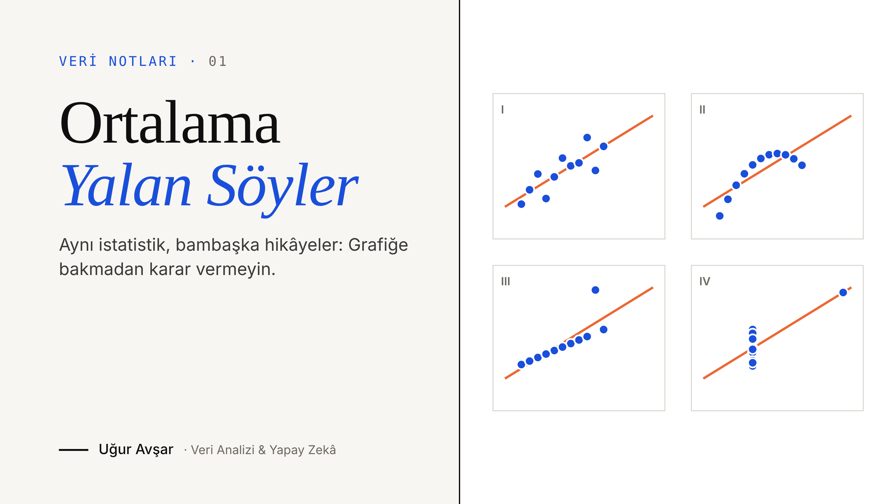

# Veri Notları — Medium Makaleleri

Medium’da yazdığım veri analizi, istatistik ve makine öğrenmesi yazılarının kodları.
Her klasörde ilgili makalenin tüm grafiklerini ve rakamlarını baştan üreten, çalıştırılmış bir Jupyter notebook bulunur.

**Yazar:** Uğur Avşar · [Medium](https://medium.com/@uguravsar10) · [LinkedIn](https://www.linkedin.com/in/uguravsarr)

---

## Makaleler

| # | Makale | Konular | Kod |
|---|--------|---------|-----|
| 01 | [Ortalama Yalan Söyler: Grafiğe Bakmadan Karar Vermeyin](https://medium.com/@uguravsar10/ortalama-yalan-s%C3%B6yler-grafi%C4%9Fe-bakmadan-karar-vermeyin-84ab115d802a) | Tanımlayıcı istatistik · EDA · Veri görselleştirme · Veri kalitesi | [`01_ortalama_yalan_soyler`](01_ortalama_yalan_soyler/) |

---

## 01 · Ortalama Yalan Söyler



📖 **[Makaleyi Medium’da oku](https://medium.com/@uguravsar10/ortalama-yalan-s%C3%B6yler-grafi%C4%9Fe-bakmadan-karar-vermeyin-84ab115d802a)**

Tek bir özet istatistiğin (ortalama, korelasyon) neden yanıltıcı olabileceğini üç örnekle gösterir:

1. **Taksi ücretleri:** Sağa çarpık dağılımda ortalama (13,09 $) ile medyan (9,50 $) arasındaki fark; yolcuların %70’i ortalamanın altında ödüyor.
2. **Anscombe Dörtlüsü:** Özet istatistikleri aynı, grafikleri bambaşka dört veri seti.
3. **Bahşişler:** Yolculukların %36’sında bahşiş sıfır görünüyor; ödeme yöntemine göre ayırınca bunun nakit bahşişlerin kayda girmemesinden kaynaklandığı ortaya çıkıyor.

**Veri**
- NYC Taxi & Limousine Commission (TLC) kayıtlarından alınmış, Mart 2019’a ait 6.433 taksi yolculuğu — [seaborn `taxis` örnek veri seti](https://github.com/mwaskom/seaborn-data)
- Anscombe, F. J. (1973). *Graphs in Statistical Analysis.* The American Statistician, 27(1), 17–21.

---

## Çalıştırma

```bash
git clone https://github.com/Uguravsar75/medium-makaleler.git
cd medium-makaleler
pip install -r requirements.txt
jupyter notebook 01_ortalama_yalan_soyler/ortalama_yalan_soyler.ipynb
```

Veri, notebook içinde doğrudan internetten okunur; ayrıca indirme gerekmez.
