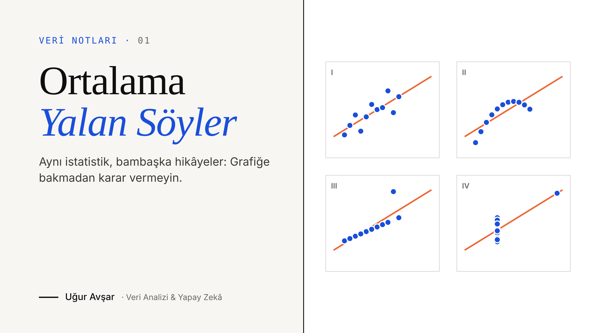
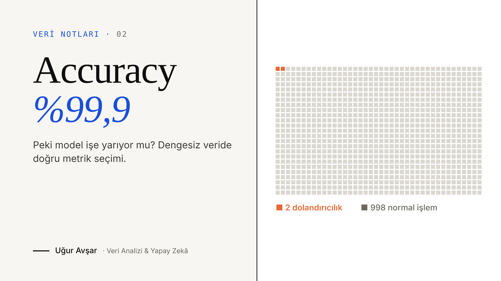
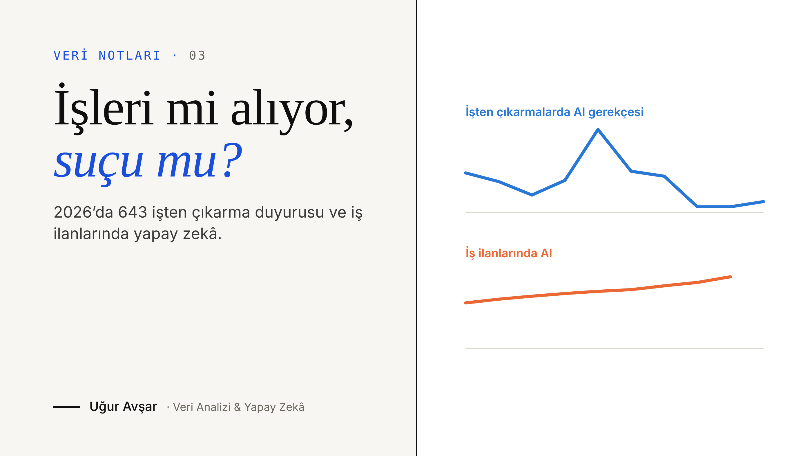
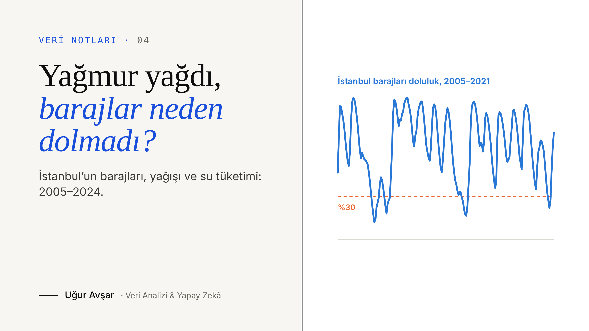

# Veri Notları — Medium Makaleleri

[English](README.md) | **Türkçe**

Medium’da yazdığım veri analizi, istatistik ve makine öğrenmesi yazılarının kodları.
Her klasörde ilgili makalenin tüm grafiklerini ve rakamlarını baştan üreten, çalıştırılmış bir Jupyter notebook bulunur.

**Yazar:** Uğur Avşar · [Medium](https://medium.com/@uguravsar10) · [LinkedIn](https://www.linkedin.com/in/uguravsarr)

---

## Makaleler

| # | Makale | Konular | Kod |
|---|--------|---------|-----|
| 01 | [Ortalama Yalan Söyler: Grafiğe Bakmadan Karar Vermeyin](https://medium.com/@uguravsar10/ortalama-yalan-s%C3%B6yler-grafi%C4%9Fe-bakmadan-karar-vermeyin-84ab115d802a) | Tanımlayıcı istatistik · EDA · Veri görselleştirme · Veri kalitesi | [`01_ortalama_yalan_soyler`](01_ortalama_yalan_soyler/) |
| 02 | [Accuracy %99,9, Peki Model İşe Yarıyor mu? Dengesiz Veride Doğru Metrik Seçimi](https://medium.com/@uguravsar10/accuracy-99-9-peki-model-i%CC%87%C5%9Fe-yar%C4%B1yor-mu-dengesiz-veride-do%C4%9Fru-metrik-se%C3%A7imi-1583749e6dc8) | Dengesiz veri · Precision/Recall · ROC vs PR · Karar eşiği | [`02_accuracy_yaniltir`](02_accuracy_yaniltir/) |
| 03 | [Yapay Zekâ İşleri mi Alıyor, Yoksa Sadece Suçu mu Üstleniyor?](https://medium.com/@uguravsar10/yapay-zek%C3%A2-i%CC%87%C5%9Fleri-mi-al%C4%B1yor-yoksa-sadece-su%C3%A7u-mu-%C3%BCstleniyor-71f44f79ce58) | Veri doğrulama · Zaman serisi · Bootstrap / Mann-Whitney · Power BI | [`03_ai_isten_cikarma`](03_ai_isten_cikarma/) |
| 04 | [Yağmur Yağdı, Barajlar Neden Dolmadı? İstanbul’un Suyunu Veriyle Okumak](https://medium.com/@uguravsar10/ya%C4%9Fmur-ya%C4%9Fd%C4%B1-barajlar-neden-dolmad%C4%B1-i%CC%87stanbulun-suyunu-veriyle-okumak-898cf159f325) | Zaman serisi · Mevsimsellik · Korelasyonu sorgulamak · Veri kalitesi | [`04_istanbul_barajlari`](04_istanbul_barajlari/) |

---

## 01 · Ortalama Yalan Söyler



📖 **[Makaleyi Medium’da oku](https://medium.com/@uguravsar10/ortalama-yalan-s%C3%B6yler-grafi%C4%9Fe-bakmadan-karar-vermeyin-84ab115d802a)**

Tek bir özet istatistiğin (ortalama, korelasyon) neden yanıltıcı olabileceğini üç örnekle gösterir:

1. **Taksi ücretleri:** Sağa çarpık dağılımda ortalama (13,09 $) ile medyan (9,50 $) arasındaki fark; yolculukların %70’inde ücret ortalamanın altında.
2. **Anscombe Dörtlüsü:** Özet istatistikleri aynı, grafikleri bambaşka dört veri seti.
3. **Bahşişler:** Yolculukların %36’sında bahşiş sıfır görünüyor; ödeme yöntemine göre ayırınca bunun nakit bahşişlerin kayda girmemesinden kaynaklandığı ortaya çıkıyor.

**Veri**
- NYC Taxi & Limousine Commission (TLC) kayıtlarından alınmış, Mart 2019’a ait 6.433 taksi yolculuğu — [seaborn `taxis` örnek veri seti](https://github.com/mwaskom/seaborn-data)
- Anscombe, F. J. (1973). *Graphs in Statistical Analysis.* The American Statistician, 27(1), 17–21.

---

## 02 · Accuracy %99,9, Peki Model İşe Yarıyor mu?



📖 **[Makaleyi Medium’da oku](https://medium.com/@uguravsar10/accuracy-99-9-peki-model-i%CC%87%C5%9Fe-yar%C4%B1yor-mu-dengesiz-veride-do%C4%9Fru-metrik-se%C3%A7imi-1583749e6dc8)**

Dengesiz veride accuracy’nin neden yanıltıcı olabileceğini ve bir sınıflandırma modelini hangi ölçütlerle değerlendirebileceğimizi gösterir:

1. **Tembel model:** Her işleme “normal” diyen model test setinde %99,87 doğruluk alıyor, ama hiçbir dolandırıcılığı yakalamıyor.
2. **Üç model karşılaştırması:** Lojistik regresyon dolandırıcılıkların %49’unu, dengeli (class_weight="balanced") model %88’ini yakalıyor; accuracy ise üçünde birbirine çok yakın.
3. **ROC vs Precision–Recall:** Aynı model için ROC-AUC 0,97, average precision 0,71.
4. **Karar eşiği:** Eşik, eğitim verisinde zaman sıralı çapraz doğrulamayla maliyete göre seçildiğinde, varsayımlarla test setindeki toplam maliyet yaklaşık %60 azalıyor.

**Veri**
- Kredi kartı dolandırıcılığı veri seti — Eylül 2013, Avrupalı kart sahiplerinin iki günlük 284.807 işlemi (492 dolandırıcılık). ULB Machine Learning Group & Worldline; Kaggle’da “Credit Card Fraud Detection”. Notebook, verinin herkese açık bir GitHub kopyasını kullanır (~100 MB).
- Dal Pozzolo, A., Caelen, O., Johnson, R. A. & Bontempi, G. (2015). *Calibrating Probability with Undersampling for Unbalanced Classification.* IEEE SSCI, 159–166.

---

## 03 · Yapay Zekâ İşleri mi Alıyor, Yoksa Sadece Suçu mu Üstleniyor?



📖 **[Makaleyi Medium’da oku](https://medium.com/@uguravsar10/yapay-zek%C3%A2-i%CC%87%C5%9Fleri-mi-al%C4%B1yor-yoksa-sadece-su%C3%A7u-mu-%C3%BCstleniyor-71f44f79ce58)**

Softito Veri Analitiği bitirme projemin hikâyesi: 2026’daki 643 işten çıkarma duyurusunu haber kaynaklarıyla karşılaştırıp şirketlerin AI’ı gerçekte ne sıklıkla gerekçe gösterdiğine ve aynı dönemde iş ilanlarında ne olduğuna bakar:

1. **Veri doğrulama:** 146 satır elle kontrol edildi; yanlış yıla ait 4 duyuru çıkarıldı, 2 rakam düzeltildi.
2. **Dar ve geniş tanım:** Kişilerin %16,9’u şirketin AI’ı açıkça gerekçe gösterdiği duyurularda; tüm AI etiketleri sayılırsa üst sınır %38,4.
3. **Aylık eğilim:** AI gerekçesi Mayıs’ta zirve yaptı (duyuruların %40’ı), Ağustos’tan sonra %3–5’e geriledi.
4. **Büyüklük:** AI gerekçeli duyuruların medyanı 295 kişi, diğerlerinin 180 (fark için %95 bootstrap GA 50–421).
5. **İşe alım tarafı:** AI’dan bahseden ABD iş ilanlarının payı bir yılda %3,6’dan %7,2’ye çıktı (neden-sonuç iddiası değildir).

**Veri**
- Projenin temizlenmiş dosyaları: [Uguravsar75/ai-layoffs-vs-hiring-2026](https://github.com/Uguravsar75/ai-layoffs-vs-hiring-2026)
- layoffhedge.com 2026 işten çıkarma listesi (8 Kasım 2026 sürümü) · Indeed Hiring Lab AI Tracker (CC BY 4.0) · Challenger, Gray & Christmas aylık raporları

---

## 04 · Yağmur Yağdı, Barajlar Neden Dolmadı?



📖 **[Makaleyi Medium’da oku](https://medium.com/@uguravsar10/ya%C4%9Fmur-ya%C4%9Fd%C4%B1-barajlar-neden-dolmad%C4%B1-i%CC%87stanbulun-suyunu-veriyle-okumak-898cf159f325)**

İBB’nin açık verisiyle İstanbul barajlarının doluluğuna, havzalara düşen yağışa ve su tüketimine bakar:

1. **Kurak dönemler:** 2005–2021 arasında doluluk 2007–2008, 2014 ve 2020–2021’de %30’un altına indi (toplam 638 gün; en düşük %9,2, Kasım 2007).
2. **Yıllık döngü:** Yağışın %53,9’u Kasım–Mart’ta düşüyor; barajlar Nisan’da zirve, Kasım’da dip yapıyor, tüketim Temmuz’da en yüksek.
3. **2014:** Su yılı yağışı ortalamanın üstündeydi ama kış dokuz yılın en kurağıydı; barajlar 16 Eylül 2014’te %14,5’e indi.
4. **Korelasyonu sorgulamak:** Kış yağışı ile bahar zirvesi arasındaki 0,62’lik korelasyon büyük ölçüde 2014’ten geliyor; 2014 hariç −0,04.
5. **Tüketim:** Ortalama günlük tüketim 2011’den 2023’e %35,6 arttı ve hiçbir yıl düşmedi.

**Veri**
- İBB Açık Veri Portalı (İSKİ verileri): baraj doluluk oranı (2005–2021), havza yağışı ve günlük su tüketimi (2011–2024). Ham dosyalar: [Uguravsar75/istanbul-baraj-analizi](https://github.com/Uguravsar75/istanbul-baraj-analizi)

---

## Çalıştırma

```bash
git clone https://github.com/Uguravsar75/medium-makaleler.git
cd medium-makaleler
pip install -r requirements.txt
jupyter notebook   # klasörlerden istediğiniz notebook’u açın
```

Veriler notebook’ların içinde doğrudan internetten okunur; ayrıca indirme gerekmez.
